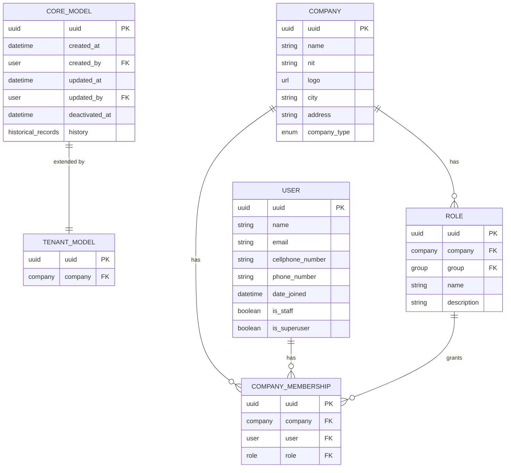

# Data model

The ER diagram for Proyecto3. Right now it holds only the **shared kernel** — the base models and IAM tables
every bounded context inherits from, which are stack-level and identical across Gestiion projects. Add this
project's own entities as they land; a model that exists in code but not here is a model the next person has
to read migrations to understand.

The domain-specific reference to see a fully-populated version of this file:
`../../Logistics/db/db_modeling.md`.

## Conventions this diagram encodes

- **Every table is a `CORE_MODEL`**: uuid PK, `created_by`/`updated_by` audit FKs, and a `deactivated_at`
  timestamp — **deletes are soft by default**. `django-simple-history` keeps the row's history.
- **Tenant-owned tables are `TENANT_MODEL`**: `CORE_MODEL` plus a `company` FK. Every query against them is
  filtered by the caller's company; that filter is the tenant boundary, and it lives in the view's
  `get_queryset()`, never in the frontend.
- **Authorization is `COMPANY_MEMBERSHIP` → `ROLE` → Django `Group` → permissions.** A user has no
  permissions of their own; they have a membership in a company, and the membership's role carries them.
  Permissions are baked into the JWT at login, so a role change needs a re-login to take effect.
- **Uniqueness is per tenant, not global** — a name unique across one company is normally
  `unique_together = ("company", "name")`, not `unique=True`.
