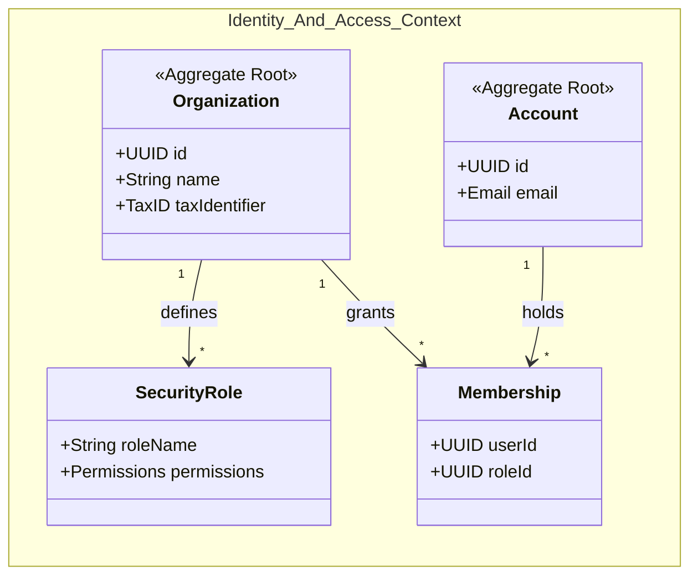

# Aggregates & bounded contexts

The strategic design view: which bounded contexts exist, what each one owns, and where the aggregate roots
sit. This is the document to argue about **before** writing a model — the class diagram in
[db.md](db.md) and the ER diagram in [../db/db_modeling.md](../db/db_modeling.md) are its consequences,
not its input.

> **Bootstrap status.** Only the shared kernel and IAM are decided (they come with the stack). The product
> contexts are Proyecto3's to define. A worked example of what this file looks like when it is finished:
> `../../Logistics/ddd/aggregates.md`.

## Rules this diagram has to keep obeying

- **One aggregate root per transaction.** A use case that has to mutate two roots atomically is a signal the
  boundary is drawn in the wrong place — check that before reaching for a bigger `@transaction.atomic`.
- **References across contexts are by id, never by object.** A context reaches another only through a driven
  port and an `infrastructure/adapter` that returns a DTO. If this diagram grows an arrow that crosses a
  context boundary into a non-root, the arrow is the bug.
- **Invariants belong to a root.** If a rule spans two roots, it belongs in a domain service in the context
  that owns the decision — not split across two `clean()` methods that can each pass alone.

## Contexts to define

| Context | Owns | Aggregate root(s) | Status |
| ------- | ---- | ----------------- | ------ |
| `core` | Shared kernel: base models, DTOs, permissions base, error handling | — (no aggregates of its own) | **fixed by the stack** |
| `users` | Accounts, authentication | `Account` | **fixed by the stack** |
| `companies` | The tenant, roles, memberships | `Organization` | **fixed by the stack** |
| *(product context 1)* | | | to define |
| *(product context 2)* | | | to define |

Fill the empty rows before the first product model is written, and keep the diagram above in sync — a stale
strategic diagram is worse than none, because it gets trusted.
