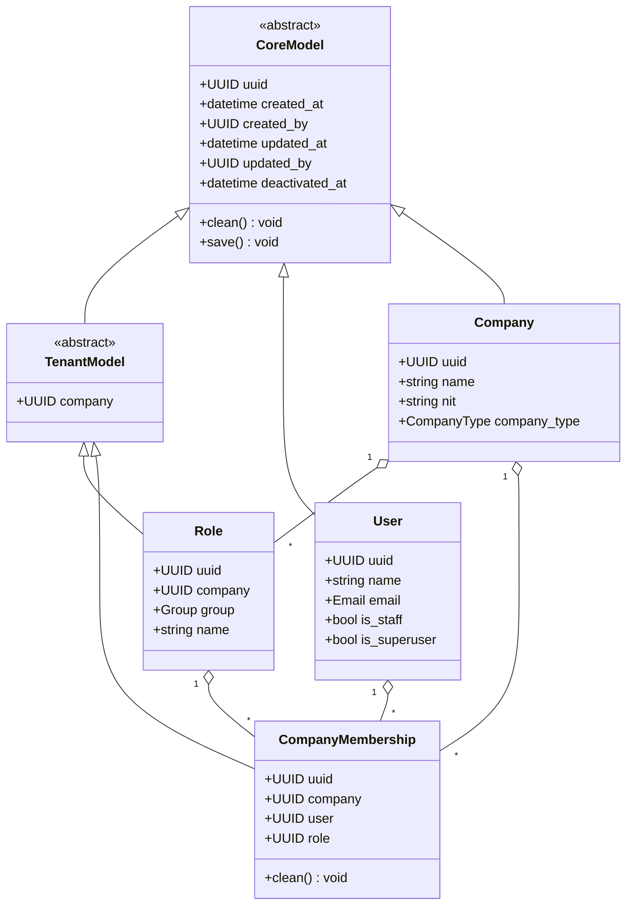

# Domain model (class view)

The tactical design view: entities, value objects and their relationships as the code declares them —
one step closer to the Django models than [aggregates.md](aggregates.md), one step further from the
physical tables than [../db/db_modeling.md](../db/db_modeling.md).

> **Bootstrap status.** Only the shared kernel is drawn. Extend it as entities land. Worked example:
> `../../Logistics/ddd/db.md`.

## Reading this diagram

- **`clean()` on a class means it carries invariants.** `CompanyMembership.clean()` is the canonical example:
  it rejects a membership whose role belongs to another company, and an inactive role. Those raise a
  `DomainError` subclass, never Django's `ValidationError` — see
  [../backend/exceptions.md](../backend/exceptions.md) and the `ddd-domain-errors` skill.
- **`CoreModel.save()` calls `full_clean()`**, which is why an invariant in `clean()` is enforced on every
  write path including the admin and the seed generators — not just through the API.
- **Inheritance here is Django abstract-base inheritance**, so `TenantModel` adds a real `company` column to
  every concrete subclass; there is no join to a base table.
